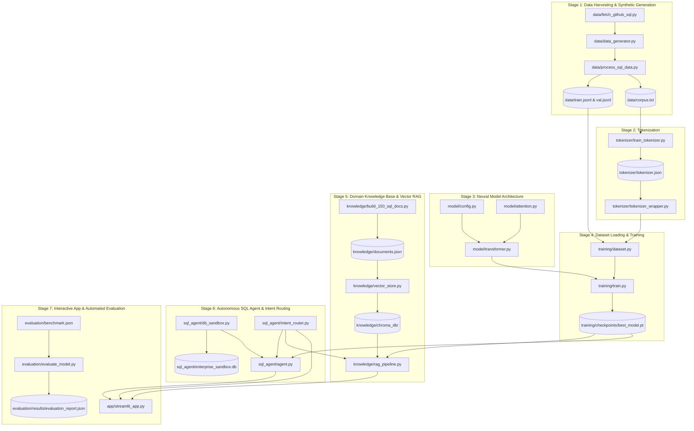

# 📁 Tiny SQL LLM — Codebase Architecture & File Roles Guide

This document provides an exhaustive, sequential catalog of **every file in the Tiny SQL LLM project**, detailing its role, the code/classes/functions it contains, what it does, and how each file connects in the end-to-end execution pipeline.

---

## 🧭 1. Sequential Execution Flow Overview

The project follows a rigorous 7-stage sequential pipeline from raw data harvesting to neural training and interactive deployment:

---

## 🗂️ 2. Comprehensive File Catalog & Role Breakdown

Below is the complete breakdown of every file grouped by module in chronological sequence.

---

### 📦 Module 1: Data Engineering (`data/`)

#### 1. [`data/fetch_github_sql.py`](file:///c:/Users/akatre/OneDrive%20-%20Nice%20Software%20Solutions/Desktop/Tiny%20LLM/data/fetch_github_sql.py)
* **Execution Sequence:** **Step 1 (First file executed)**
* **Role:** Automated open-source SQL repository scraper & cloner.
* **What Code is Inside:**
  - `REPOSITORIES` dictionary defining 7 curated GitHub repositories (`hello-sql`, `sql-tutorial`, `sql-ultimate-course`, `sql-masterclass`, `complete-intro-to-sql`, `sql-queries`, `sql-practice-problems`).
  - `clone_or_update_repo(repo_info, target_dir)`: Uses `git clone` / `git pull` subprocesses to download clean SQL repositories into `data/raw_repos/`.
  - `main()`: Iterates over the repository list and logs progress.
* **Input:** Remote GitHub repository URLs.
* **Output:** Local cloned directories in `data/raw_repos/`.

#### 2. [`data/data_generator.py`](file:///c:/Users/akatre/OneDrive%20-%20Nice%20Software%20Solutions/Desktop/Tiny%20LLM/data/data_generator.py)
* **Execution Sequence:** **Step 2**
* **Role:** Enterprise synthetic relational SQL pair generator.
* **What Code is Inside:**
  - `EnterpriseSQLDataGenerator` class containing parametric schema templates across 12 business domains (E-Commerce, HR/Payroll, Banking/Fintech, Healthcare, SaaS Analytics, Logistics/Supply Chain, Telecommunications, Gaming, Education, Real Estate, Cybersecurity, Airlines).
  - Procedural SQL query templates covering Simple SELECT, Relational Joins, Complex Aggregations, Window Functions (`ROW_NUMBER`, `RANK`, `NTILE`, `LAG`, `LEAD`), Multi-stage CTEs, Recursive CTEs, Subqueries, and DDL/DML operations.
  - `generate_dataset(n_samples)`: Dynamically generates structured question-to-SQL JSON pairs.
* **Input:** Procedural schemas and parametric query templates.
* **Output:** High-diversity structured SQL generation samples.

#### 3. [`data/process_sql_data.py`](file:///c:/Users/akatre/OneDrive%20-%20Nice%20Software%20Solutions/Desktop/Tiny%20LLM/data/process_sql_data.py)
* **Execution Sequence:** **Step 3**
* **Role:** Data pipeline orchestrator, AST validator, deduplicator, and corpus builder.
* **What Code is Inside:**
  - `clean_sql(sql_str)`: Normalizes casing, strips inline markdown/comments, and standardizes semicolons.
  - `validate_sql_with_sqlglot(sql_str)`: Uses `sqlglot` Abstract Syntax Tree parsing to eliminate invalid or broken syntax.
  - `extract_from_repos(raw_repos_dir)`: Scans cloned GitHub directories (`.sql`, `.md` code blocks) and extracts real-world queries.
  - `build_splits_and_corpus()`: Merges harvested repo data and synthetic samples (80/10/10 split), deduplicates via SHA-256 hashes, and writes the training files.
* **Input:** Cloned repos in `data/raw_repos/` + Synthetic templates.
* **Output:** 
  - `data/train.jsonl` (Training split)
  - `data/val.jsonl` (Validation split)
  - `data/corpus.txt` (Raw text corpus for tokenizer training)

---

### 🔤 Module 2: Tokenization (`tokenizer/`)

#### 4. [`tokenizer/train_tokenizer.py`](file:///c:/Users/akatre/OneDrive%20-%20Nice%20Software%20Solutions/Desktop/Tiny%20LLM/tokenizer/train_tokenizer.py)
* **Execution Sequence:** **Step 4**
* **Role:** Custom Byte-Pair Encoding (BPE) tokenizer trainer.
* **What Code is Inside:**
  - Hugging Face `tokenizers` BPE model initialization with `vocab_size=4096`.
  - `ByteLevel` pre-tokenizer and decoders for lossless whitespace and punctuation handling.
  - `BpeTrainer` configured with special tokens: `<unk>`, `<s>`, `</s>`, `<pad>`, `<mask>`, `<schema>`, `</schema>`, `<sql>`, `</sql>`.
  - `train_custom_tokenizer(corpus_path, output_path)`: Reads `data/corpus.txt`, trains the vocabulary, and exports the serialized model.
* **Input:** `data/corpus.txt`.
* **Output:** `tokenizer/tokenizer.json` (4,096-token specialized SQL vocabulary).

#### 5. [`tokenizer/tokenizer_wrapper.py`](file:///c:/Users/akatre/OneDrive%20-%20Nice%20Software%20Solutions/Desktop/Tiny%20LLM/tokenizer/tokenizer_wrapper.py)
* **Execution Sequence:** **Step 5 (Loaded during training & inference)**
* **Role:** High-level Python wrapper for encoding, decoding, and tensor conversion.
* **What Code is Inside:**
  - `SQLTokenizer` class wrapping `tokenizers.Tokenizer.from_file()`.
  - Properties for special token IDs: `pad_token_id`, `bos_token_id`, `eos_token_id`, `unk_token_id`.
  - `encode(text, max_length, padding, truncation)`: Converts text to PyTorch `torch.Tensor` with attention masks.
  - `decode(ids, skip_special_tokens)`: Converts token IDs back into human-readable SQL strings.
* **Input:** `tokenizer/tokenizer.json` + Text strings.
* **Output:** PyTorch tensor batches and decoded strings.

---

### 🧠 Module 3: Neural Transformer Architecture (`model/`)

#### 6. [`model/config.py`](file:///c:/Users/akatre/OneDrive%20-%20Nice%20Software%20Solutions/Desktop/Tiny%20LLM/model/config.py)
* **Execution Sequence:** **Step 6**
* **Role:** Centralized model hyperparameter configuration dataclass.
* **What Code is Inside:**
  - `@dataclass ModelConfig`:
    - `vocab_size: int = 4096`
    - `d_model: int = 256`
    - `n_layers: int = 6`
    - `n_heads: int = 8` (head dimension = 32)
    - `d_ff: int = 768` (SwiGLU hidden dimension)
    - `max_seq_len: int = 256`
    - `dropout: float = 0.1`
    - `tie_word_embeddings: bool = True`
* **Input:** Default parameter definitions.
* **Output:** Instantiated configuration object consumed by Transformer layers.

#### 7. [`model/attention.py`](file:///c:/Users/akatre/OneDrive%20-%20Nice%20Software%20Solutions/Desktop/Tiny%20LLM/model/attention.py)
* **Execution Sequence:** **Step 7**
* **Role:** Rotary Positional Embedding (RoPE) and Causal Multi-Head Self-Attention.
* **What Code is Inside:**
  - `apply_rotary_pos_emb(q, k, cos, sin)`: Computes 2D complex plane rotation on Query and Key vectors for relative token distance tracking.
  - `RotaryEmbedding` class: Precomputes cosine and sine frequency matrices.
  - `CausalSelfAttention` class: Computes scaled dot-product multi-head attention with lower-triangular causal mask to prevent lookahead cheating.
* **Input:** Query, Key, Value tensors $(B, N, T, d_k)$.
* **Output:** Context-aware attention output $(B, T, d_{\text{model}})$.

#### 8. [`model/transformer.py`](file:///c:/Users/akatre/OneDrive%20-%20Nice%20Software%20Solutions/Desktop/Tiny%20LLM/model/transformer.py)
* **Execution Sequence:** **Step 8**
* **Role:** Full 6.16M parameter Decoder-only Transformer Neural Network.
* **What Code is Inside:**
  - `RMSNorm` class: Root Mean Square layer normalization without mean-centering overhead.
  - `SwiGLU` class: Gated feed-forward network $(\text{SiLU}(x W_1) \odot (x W_3)) W_2$.
  - `TransformerBlock` class: Residual block combining RMSNorm, CausalSelfAttention with RoPE, and SwiGLU.
  - `TinySQLTransformer` class: Full model combining Token Embeddings, 6 Transformer Blocks, Final RMSNorm, and Tied Linear Language Model Head.
  - `generate()` method: Autoregressive decoding with temperature and top-$k$ sampling.
* **Input:** Token ID tensors $(B, T)$.
* **Output:** Next-token logits $(B, T, \text{vocab\_size})$.

---

### 🏋️ Module 4: Neural Model Training (`training/`)

#### 9. [`training/dataset.py`](file:///c:/Users/akatre/OneDrive%20-%20Nice%20Software%20Solutions/Desktop/Tiny%20LLM/training/dataset.py)
* **Execution Sequence:** **Step 9**
* **Role:** PyTorch Dataset loader, format builder, and loss mask generator.
* **What Code is Inside:**
  - `SQLDataset(torch.utils.data.Dataset)` class.
  - Formats raw JSONL samples into structured prompt format: `<s>User prompt <sql>TARGET_SQL</s>`.
  - Implements prompt loss masking: sets label target to `-100` on the input prompt so `CrossEntropyLoss` only computes loss on the generated SQL tokens.
  - `collate_fn`: Dynamically pads batches to the longest sequence in the batch using `pad_token_id`.
* **Input:** `data/train.jsonl`, `data/val.jsonl`, `tokenizer/tokenizer_wrapper.py`.
* **Output:** PyTorch `DataLoader` yielding `(input_ids, labels, attention_mask)` batches.

#### 10. [`training/train.py`](file:///c:/Users/akatre/OneDrive%20-%20Nice%20Software%20Solutions/Desktop/Tiny%20LLM/training/train.py)
* **Execution Sequence:** **Step 10**
* **Role:** Neural network training engine, optimization loop, and checkpoint manager.
* **What Code is Inside:**
  - AdamW optimizer ($\text{lr}=10^{-3}, \text{weight\_decay}=0.01$) with Cosine Annealing learning rate schedule.
  - Training loop with gradient clipping (`max_norm=1.0`).
  - Validation loop computing cross-entropy loss and perplexity.
  - Checkpoint manager: saves weights when validation loss improves.
* **Input:** `training/dataset.py`, `model/transformer.py`.
* **Output:** `training/checkpoints/best_model.pt` (Epoch 5 checkpoint, Validation Loss 2.4371).

---

### 📚 Module 5: Pure SQL Knowledge Base & Vector RAG (`knowledge/`)

#### 11. [`knowledge/build_150_sql_docs.py`](file:///c:/Users/akatre/OneDrive%20-%20Nice%20Software%20Solutions/Desktop/Tiny%20LLM/knowledge/build_150_sql_docs.py)
* **Execution Sequence:** **Step 11**
* **Role:** Master builder script compiling the exhaustive 194-document SQL knowledge base.
* **What Code is Inside:**
  - 16 exhaustive categorized document dictionaries covering all SQL concepts (Roadmaps, Clauses, Joins, Aggregations, Window Functions, CTEs, Subqueries, DDL, DML, Transactions/Locks, Indexes, Objects/Triggers, Data Types, Normalization, Security, Dialects).
  - Formats clean markdown, avoids raw unescaped LaTeX math characters to prevent UI glitches, and adds exhaustive alias/tag lists.
  - `build_all_documents()`: Compiles all categories and saves `knowledge/documents.json`.
* **Input:** Python structured domain knowledge definitions.
* **Output:** `knowledge/documents.json` (194 structured documents).

#### 12. [`knowledge/documents.json`](file:///c:/Users/akatre/OneDrive%20-%20Nice%20Software%20Solutions/Desktop/Tiny%20LLM/knowledge/documents.json)
* **Execution Sequence:** **Step 12**
* **Role:** Persistent JSON data store for the entire relational SQL domain ontology.
* **What Data is Inside:**
  - 194 unique objects with fields: `id`, `domain`, `topic`, `title`, `tags`, `content`, `source`.
* **Input:** Created by `build_150_sql_docs.py`.
* **Output:** Consumed by `vector_store.py`.

#### 13. [`knowledge/vector_store.py`](file:///c:/Users/akatre/OneDrive%20-%20Nice%20Software%20Solutions/Desktop/Tiny%20LLM/knowledge/vector_store.py)
* **Execution Sequence:** **Step 13**
* **Role:** ChromaDB persistent vector database with hybrid semantic search and tag boosting.
* **What Code is Inside:**
  - `ACRONYM_MAP`: 40+ acronym expansions (`SP`, `CTE`, `UDF`, `MV`, `PK`, `FK`, `ACID`, `SARGable`, `1NF`, `2NF`, `3NF`, etc.).
  - `normalize_sql_query(query)`: Expands acronyms and splits camelCase terms.
  - `DomainVectorStore` class: Initializes persistent ChromaDB client in `knowledge/chroma_db/`.
  - `ingest_documents()`: Embeds and stores all documents into collection `sql_domain_knowledge`.
  - `search(query, n_results)`: Performs hybrid ranking combining dense vector cosine similarity with tag matching boosts ($+0.40$).
* **Input:** `knowledge/documents.json` + User search queries.
* **Output:** Ranked list of retrieved knowledge chunks.

#### 14. [`knowledge/rag_pipeline.py`](file:///c:/Users/akatre/OneDrive%20-%20Nice%20Software%20Solutions/Desktop/Tiny%20LLM/knowledge/rag_pipeline.py)
* **Execution Sequence:** **Step 14**
* **Role:** Pedagogical knowledge synthesizer and dynamic entity comparison engine.
* **What Code is Inside:**
  - `TinyLLMRAG` class.
  - `extract_comparison_entities(question)`: Regex parser extracting comparison subjects (`difference between X and Y`, `X vs Y`).
  - `synthesize_dynamic_comparison(ent1, ent2, question)`: Dynamically retrieves knowledge for both entities from ChromaDB and synthesizes side-by-side comparative markdown tables.
  - `format_pedagogical_markdown(top_doc)`: Formats retrieved knowledge into structured markdown sections (Overview $\to$ Syntax $\to$ Code Examples $\to$ Execution Rules) with clean fenced code blocks.
  - `answer_with_rag(question)`: High-level entry point handling conceptual and educational queries.
* **Input:** Natural language user questions.
* **Output:** Rich, educational markdown tutorials and comparative tables.

---

### 🤖 Module 6: Autonomous SQL Agent & Sandbox Execution (`sql_agent/`)

#### 15. [`sql_agent/intent_router.py`](file:///c:/Users/akatre/OneDrive%20-%20Nice%20Software%20Solutions/Desktop/Tiny%20LLM/sql_agent/intent_router.py)
* **Execution Sequence:** **Step 15 (First step of every user interaction)**
* **Role:** Zero-hardcoding linguistic NLP intent router.
* **What Code is Inside:**
  - `UserIntent` Enum (`TEXT_TO_SQL`, `CONCEPT_EXPLANATION`, `CONCEPT_COMPARISON`, `QUERY_OPTIMIZATION`, `GENERAL_SQL_CHAT`).
  - `classify_user_intent(prompt)`: Linguistic pattern matching analyzing sentence structure, question stems (`what is`, `how to`, `difference between`, `roadmap`), and actionable database verbs (`show`, `find`, `list`, `get`).
* **Input:** Raw user chat message.
* **Output:** Classified `UserIntent` route.

#### 16. [`sql_agent/db_sandbox.py`](file:///c:/Users/akatre/OneDrive%20-%20Nice%20Software%20Solutions/Desktop/Tiny%20LLM/sql_agent/db_sandbox.py)
* **Execution Sequence:** **Step 16**
* **Role:** In-memory & disk-backed SQLite database sandbox with enterprise schemas.
* **What Code is Inside:**
  - `DatabaseSandbox` class managing SQLite connections.
  - Pre-populates 5 enterprise relational tables with foreign keys and real sample rows:
    - `employees` (employee_id, first_name, last_name, department_id, salary, hire_date, role)
    - `departments` (department_id, department_name, manager_id, location, budget)
    - `customers` (customer_id, first_name, last_name, email, region, segment, join_date)
    - `orders` (order_id, customer_id, order_date, total_amount, status, payment_method)
    - `order_items` (item_id, order_id, product_name, category, unit_price, quantity)
  - `get_schema_context()`: Extracts table DDL and column metadata for dynamic in-context prompt injection.
  - `execute_query(sql)`: Executes queries safely with execution timing and error handling.
* **Input:** SQL statements.
* **Output:** Execution dictionary `{"success": bool, "columns": list, "rows": list, "row_count": int, "error": str}`.

#### 17. [`sql_agent/agent.py`](file:///c:/Users/akatre/OneDrive%20-%20Nice%20Software%20Solutions/Desktop/Tiny%20LLM/sql_agent/agent.py)
* **Execution Sequence:** **Step 17**
* **Role:** Autonomous SQL Generation and Execution Agent.
* **What Code is Inside:**
  - `SQLAgent` class orchestrating neural generation and live database execution.
  - `generate_sql(prompt)`: Injects live database schema into the prompt, passes it to `TinyLLMInference`, and extracts generated SQL.
  - Step 2: AST validation and transpilation via `sqlglot`.
  - Step 3: Live execution on `DatabaseSandbox`.
  - Step 4: `explain_results()`: Dynamically formats query results and column previews.
* **Input:** Natural language database queries (e.g., "Find top 5 highest salaried employees").
* **Output:** Generated SQL, live execution results, and natural language summary.

---

### 💻 Module 7: Inference & Interactive Application (`inference/` & `app/`)

#### 18. [`inference/generate.py`](file:///c:/Users/akatre/OneDrive%20-%20Nice%20Software%20Solutions/Desktop/Tiny%20LLM/inference/generate.py)
* **Execution Sequence:** **Step 18**
* **Role:** Standalone neural inference engine for direct model generation.
* **What Code is Inside:**
  - `TinyLLMInference` class.
  - Loads PyTorch checkpoint (`best_model.pt`) and initializes `SQLTokenizer`.
  - `generate_sql(prompt, max_new_tokens, temperature)`: Runs autoregressive generation and strips special tokens.
  - `answer(question)`: Generates general SQL responses.
* **Input:** Model weights + User prompt.
* **Output:** Generated raw text string.

#### 19. [`app/streamlit_app.py`](file:///c:/Users/akatre/OneDrive%20-%20Nice%20Software%20Solutions/Desktop/Tiny%20LLM/app/streamlit_app.py)
* **Execution Sequence:** **Step 19 (Web User Interface)**
* **Role:** Modern Streamlit Web Application for interactive pair programming and learning.
* **What Code is Inside:**
  - Custom CSS styling with dark mode aesthetics, glassmorphism cards, and syntax highlighting.
  - Sidebar with Live Relational Schema Explorer, Knowledge Base document count badge, and quick query starters.
  - Multi-track chat interface connected to `classify_user_intent`:
    - **Concept & Education Queries** $\rightarrow$ Rendered via `TinyLLMRAG` with formatted markdown tutorials.
    - **Comparison Queries** $\rightarrow$ Rendered with dynamic comparative tables.
    - **Database Action Queries** $\rightarrow$ Executed live via `SQLAgent`, displaying SQL code blocks, execution latency, and interactive Pandas DataFrames.
* **Input:** User browser interaction.
* **Output:** Visual, interactive web application running on local port `8501`.

---

### 🧪 Module 8: Evaluation & Quality Assurance (`evaluation/`)

#### 20. [`evaluation/benchmark.json`](file:///c:/Users/akatre/OneDrive%20-%20Nice%20Software%20Solutions/Desktop/Tiny%20LLM/evaluation/benchmark.json)
* **Execution Sequence:** **Step 20**
* **Role:** Golden benchmark dataset for continuous validation.
* **What Data is Inside:**
  - 22 diverse test cases across Basic SELECT, Joins, Aggregations, Window Functions, CTEs, and Complex Filters.
* **Input:** Curated test questions and ground-truth validation criteria.
* **Output:** Consumed by automated evaluation scripts.

#### 21. [`evaluation/evaluate_model.py`](file:///c:/Users/akatre/OneDrive%20-%20Nice%20Software%20Solutions/Desktop/Tiny%20LLM/evaluation/evaluate_model.py)
* **Execution Sequence:** **Step 21**
* **Role:** Automated benchmark runner evaluating AST validity, SQL keywords, and execution accuracy.
* **What Code is Inside:**
  - `evaluate_model()`: Iterates through `benchmark.json`, generates SQL with `TinyLLMInference`, validates AST syntax via `sqlglot`, executes on `DatabaseSandbox`, and computes accuracy metrics.
  - Exports detailed JSON and Markdown reports to `evaluation/results/`.
* **Input:** `evaluation/benchmark.json`, `training/checkpoints/best_model.pt`.
* **Output:** `evaluation/results/evaluation_report.json` and `evaluation/results/evaluation_report.md`.

#### 22. [`evaluation/evaluate_sql.py`](file:///c:/Users/akatre/OneDrive%20-%20Nice%20Software%20Solutions/Desktop/Tiny%20LLM/evaluation/evaluate_sql.py)
* **Execution Sequence:** **Step 22**
* **Role:** Specialized SQL AST and dialect evaluation metrics script.
* **What Code is Inside:**
  - Metric functions for AST parsing success, keyword overlap F1-score, table/column reference validity, and dialect compatibility.
* **Input:** Generated SQL vs Ground Truth SQL.
* **Output:** Metric scores and validation diagnostics.

---

### 📄 Module 9: Project Documentation & Plans (Root)

#### 23. [`PROJECT_DOCUMENTATION.md`](file:///c:/Users/akatre/OneDrive%20-%20Nice%20Software%20Solutions/Desktop/Tiny%20LLM/PROJECT_DOCUMENTATION.md)
* **Role:** Master technical reference manual documenting all 10 development steps, mathematical formulas (RoPE, SwiGLU, RMSNorm), training metrics, RAG architecture, and database schemas.

#### 24. [`plan.md`](file:///c:/Users/akatre/OneDrive%20-%20Nice%20Software%20Solutions/Desktop/Tiny%20LLM/plan.md)
* **Role:** Engineering master plan and architecture blueprint detailing tasks, dependencies, and completed milestones.

---

## 📊 3. Master Summary Matrix Table

| Seq # | File Path | Primary Class / Functions | Main Role & Responsibility |
| :---: | :--- | :--- | :--- |
| **1** | [`data/fetch_github_sql.py`](file:///c:/Users/akatre/OneDrive%20-%20Nice%20Software%20Solutions/Desktop/Tiny%20LLM/data/fetch_github_sql.py) | `clone_or_update_repo()` | Clones 7 curated SQL GitHub repositories |
| **2** | [`data/data_generator.py`](file:///c:/Users/akatre/OneDrive%20-%20Nice%20Software%20Solutions/Desktop/Tiny%20LLM/data/data_generator.py) | `EnterpriseSQLDataGenerator` | Generates procedural SQL pairs across 12 business domains |
| **3** | [`data/process_sql_data.py`](file:///c:/Users/akatre/OneDrive%20-%20Nice%20Software%20Solutions/Desktop/Tiny%20LLM/data/process_sql_data.py) | `validate_sql_with_sqlglot()` | Cleans, validates AST, deduplicates, and creates dataset splits |
| **4** | [`tokenizer/train_tokenizer.py`](file:///c:/Users/akatre/OneDrive%20-%20Nice%20Software%20Solutions/Desktop/Tiny%20LLM/tokenizer/train_tokenizer.py) | `train_custom_tokenizer()` | Trains custom 4,096-token BPE tokenizer on SQL corpus |
| **5** | [`tokenizer/tokenizer_wrapper.py`](file:///c:/Users/akatre/OneDrive%20-%20Nice%20Software%20Solutions/Desktop/Tiny%20LLM/tokenizer/tokenizer_wrapper.py) | `SQLTokenizer` | Encodes text to PyTorch tensors and decodes tokens to SQL |
| **6** | [`model/config.py`](file:///c:/Users/akatre/OneDrive%20-%20Nice%20Software%20Solutions/Desktop/Tiny%20LLM/model/config.py) | `ModelConfig` | Defines model dimensions ($d=256$, 6 layers, 8 heads, $d_{\text{ff}}=768$) |
| **7** | [`model/attention.py`](file:///c:/Users/akatre/OneDrive%20-%20Nice%20Software%20Solutions/Desktop/Tiny%20LLM/model/attention.py) | `RotaryEmbedding`, `CausalSelfAttention` | Computes RoPE positional rotation and causal multi-head self-attention |
| **8** | [`model/transformer.py`](file:///c:/Users/akatre/OneDrive%20-%20Nice%20Software%20Solutions/Desktop/Tiny%20LLM/model/transformer.py) | `TinySQLTransformer`, `SwiGLU`, `RMSNorm` | 6.16M-parameter Decoder-only Transformer neural network |
| **9** | [`training/dataset.py`](file:///c:/Users/akatre/OneDrive%20-%20Nice%20Software%20Solutions/Desktop/Tiny%20LLM/training/dataset.py) | `SQLDataset`, `collate_fn` | PyTorch Dataset with prompt-loss masking and dynamic batch padding |
| **10** | [`training/train.py`](file:///c:/Users/akatre/OneDrive%20-%20Nice%20Software%20Solutions/Desktop/Tiny%20LLM/training/train.py) | `train_epoch()`, `validate()` | AdamW training loop with Cosine Annealing and checkpoint saving |
| **11** | [`knowledge/build_150_sql_docs.py`](file:///c:/Users/akatre/OneDrive%20-%20Nice%20Software%20Solutions/Desktop/Tiny%20LLM/knowledge/build_150_sql_docs.py) | `build_all_documents()` | Compiles 194 exhaustive domain documents across 16 categories |
| **12** | [`knowledge/documents.json`](file:///c:/Users/akatre/OneDrive%20-%20Nice%20Software%20Solutions/Desktop/Tiny%20LLM/knowledge/documents.json) | *(194 Structured JSON Docs)* | Central knowledge base file for all SQL domain ontology |
| **13** | [`knowledge/vector_store.py`](file:///c:/Users/akatre/OneDrive%20-%20Nice%20Software%20Solutions/Desktop/Tiny%20LLM/knowledge/vector_store.py) | `DomainVectorStore`, `ACRONYM_MAP` | ChromaDB vector store with hybrid acronym normalizer & tag boosting |
| **14** | [`knowledge/rag_pipeline.py`](file:///c:/Users/akatre/OneDrive%20-%20Nice%20Software%20Solutions/Desktop/Tiny%20LLM/knowledge/rag_pipeline.py) | `TinyLLMRAG` | Pedagogical markdown synthesizer & dynamic entity comparison engine |
| **15** | [`sql_agent/intent_router.py`](file:///c:/Users/akatre/OneDrive%20-%20Nice%20Software%20Solutions/Desktop/Tiny%20LLM/sql_agent/intent_router.py) | `classify_user_intent()` | NLP linguistic classifier routing user prompts to specialized pipelines |
| **16** | [`sql_agent/db_sandbox.py`](file:///c:/Users/akatre/OneDrive%20-%20Nice%20Software%20Solutions/Desktop/Tiny%20LLM/sql_agent/db_sandbox.py) | `DatabaseSandbox` | In-memory & SQLite sandbox with 5 relational enterprise tables |
| **17** | [`sql_agent/agent.py`](file:///c:/Users/akatre/OneDrive%20-%20Nice%20Software%20Solutions/Desktop/Tiny%20LLM/sql_agent/agent.py) | `SQLAgent` | Autonomous agent: Schema Injection $\to$ Generation $\to$ AST Check $\to$ Execution |
| **18** | [`inference/generate.py`](file:///c:/Users/akatre/OneDrive%20-%20Nice%20Software%20Solutions/Desktop/Tiny%20LLM/inference/generate.py) | `TinyLLMInference` | Loads `best_model.pt` for autoregressive token generation |
| **19** | [`app/streamlit_app.py`](file:///c:/Users/akatre/OneDrive%20-%20Nice%20Software%20Solutions/Desktop/Tiny%20LLM/app/streamlit_app.py) | `main()` | Interactive Streamlit UI with live SQL sandbox & RAG chat |
| **20** | [`evaluation/benchmark.json`](file:///c:/Users/akatre/OneDrive%20-%20Nice%20Software%20Solutions/Desktop/Tiny%20LLM/evaluation/benchmark.json) | *(22 Benchmark Test Cases)* | Golden test dataset across basic to complex SQL queries |
| **21** | [`evaluation/evaluate_model.py`](file:///c:/Users/akatre/OneDrive%20-%20Nice%20Software%20Solutions/Desktop/Tiny%20LLM/evaluation/evaluate_model.py) | `evaluate_model()` | Automated benchmark runner computing accuracy and AST validity |
| **22** | [`evaluation/evaluate_sql.py`](file:///c:/Users/akatre/OneDrive%20-%20Nice%20Software%20Solutions/Desktop/Tiny%20LLM/evaluation/evaluate_sql.py) | `evaluate_sql_pair()` | Computes SQL AST parsing rate, F1 overlap, and table correctness |
| **23** | [`PROJECT_DOCUMENTATION.md`](file:///c:/Users/akatre/OneDrive%20-%20Nice%20Software%20Solutions/Desktop/Tiny%20LLM/PROJECT_DOCUMENTATION.md) | *(Full Documentation)* | Complete A-to-Z technical architecture and step-by-step development manual |
| **24** | [`FILES_AND_ROLES.md`](file:///c:/Users/akatre/OneDrive%20-%20Nice%20Software%20Solutions/Desktop/Tiny%20LLM/FILES_AND_ROLES.md) | *(This Document)* | Exhaustive file-by-file catalog, role descriptions, and sequence guide |
